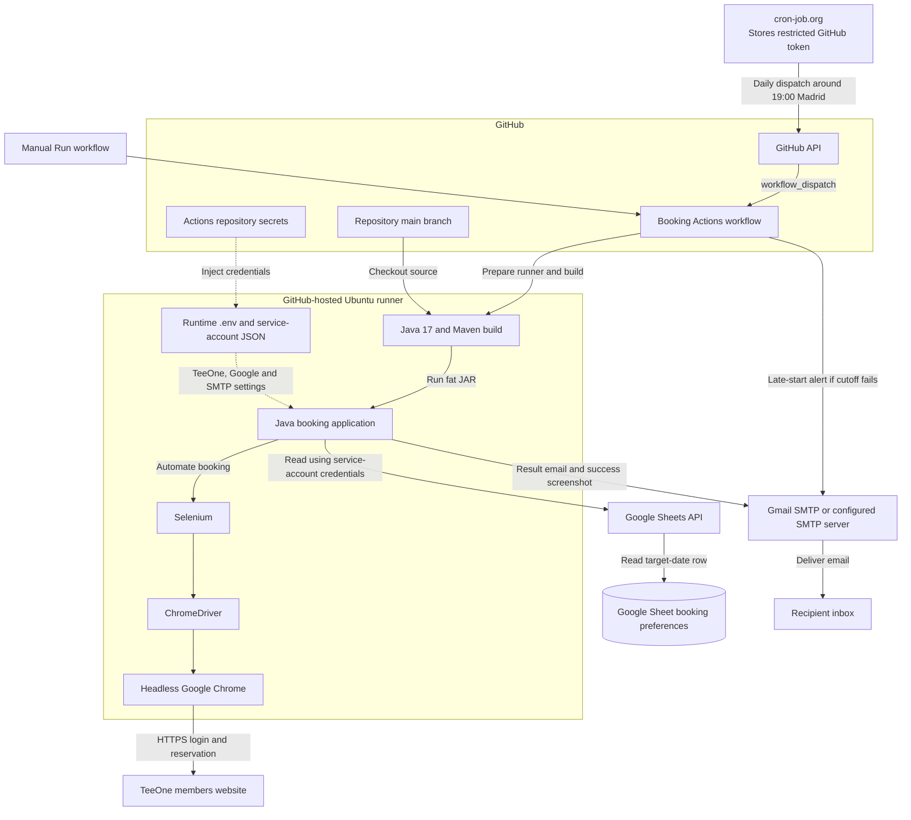

# TeeOne Golf Booking

## High-Level Summary

Java/Selenium automation for [TeeOne](https://members.teeone.golf) at Real Club
de Golf El Prat. Google Sheets supplies booking preferences; email and a public
[dashboard](https://nicokiki.github.io/java-prat-booking-dashboard/) report results.

- **Timing:** an external scheduler dispatches GitHub Actions around 19:00 Madrid;
  setup starts at 19:35, login preparation around 19:59:20, and form filling at
  **20:00:01**. Runner and site delays mean these are targets, not guarantees.
- **Sheet:** one row per play date, with course, preferred time, total players and
  the exact additional-player licences. The default target is **today + 2 days**.
- **Booking:** 18 holes; choose the closest eligible offered time within
  **+/-90 minutes**. Rosa and Amarillo fall back to each other before BLOQUEAR;
  Verde has no alternate course. There is no reservation retry after blocking
  or submission problems.
- **No target-date row:** inspect courses for two players, preferring 18 holes
  and checking 9 only where 18-hole times are unavailable, without
  choosing a time, blocking, reserving or emailing. This is Informational only
  if the inspection completes; invalid sheet data and API errors are technical.
- **Availability:** use DOM text when Selenium text is blank. A three-second
  time-dropdown wait gains **at most one extra second only for a matching pending
  request**. Confirmed empty API responses do not get that extension.
- **Results:** Confirmed, Unavailable, Technical Failure or Informational.
  A green Actions run does not prove booking success. Logs distinguish API errors
  from confirmed empty availability, while public reports exclude credentials.

**Manual execution is not a dry run.** The workflow's wait-bypass input defaults
to true. Production scheduling must explicitly set it to false; never dispatch
again merely to test publication or recover an unconfirmed reservation.

You can run it **locally** (Java + Chrome) or on **GitHub Actions** (externally scheduled or manual).

Start with [Google Sheets](#google-sheets), [repository secrets](#repository-secrets),
[external scheduling](#external-scheduling-with-cron-joborg), and
[safe validation](#safe-validation-and-execution-verification).

## Components and services

This diagram shows the GitHub Actions booking path. Solid arrows show
execution or service calls; dotted arrows show credential and configuration
inputs. Local runs use the same Java application and external services,
without cron-job.org or a GitHub runner.

<!-- mermaid-checked: no \n, no em-dash/en-dash, no {} in labels, subgraphs are id["label"], arrows are -->|"label"|, all subgraphs closed by end, ids unique -->


- **Scheduling:** cron-job.org must be configured separately. It stores a restricted GitHub token and dispatches the workflow; it does not run Java or hold the TeeOne, Google, or SMTP credentials. See [External scheduling](#external-scheduling-with-cron-joborg).
- **Execution:** Actions checks the booking cutoff, waits for the build window, checks out `main`, installs Java and Chrome, builds the JAR, and starts the app. The Java app handles the final Madrid-time waits and course/time selection.
- **Secrets:** repository secrets supply the TeeOne login, Google service-account JSON and sheet settings, and SMTP credentials and recipients. The workflow writes runtime `.env` and JSON files on the runner; secret values do not belong in source control or this diagram.
- **Google Sheets:** the Java app reads booking preferences through the Sheets API using the service account. The sheet must be shared with that service account.
- **Browser:** Selenium controls ChromeDriver, which drives headless Chrome against TeeOne. The booking itself uses the website, not the Sheets API or email.
- **Email:** the app sends success/failure details through Gmail SMTP by default, or another configured SMTP server. A confirmed success includes a screenshot when capture succeeds. The workflow can separately send a late-start alert before the app runs.

## Requirements

- **Java 17+** (Maven; set `JAVA_HOME` if needed)
- **Google Chrome** (Selenium 4 manages the driver)
- **Google Cloud** project with Sheets API and a service account
- **SMTP** (e.g. Gmail with an [app password](https://support.google.com/accounts/answer/185833)) for notifications
- **Node.js** for observer regression tests only; it is not required to run the booking JAR

## Google Sheets

Use these exact headers in row 1 and one booking row per **play date**. Format
Fecha and the licence columns as plain text; keep Horario displayed as `HH:mm`
or `H:mm`, without seconds or AM/PM.

| Fecha | Recorrido | Horario | Socios | Socio-1 | Socio-2 | Socio-3 |
|-------|-----------|---------|--------|---------|---------|---------|
| 20261111 | TEE 1 ROSA | 08:30 | 2 | 100001 | | |
| 20261112 | TEE 1 AMARILLO | 08:35 | 3 | 100001 | 100002 | |
| 20261113 | TEE 1 VERDE | 09:00 | 4 | 100001 | 100002 | 100003 |

The licence values are **fictional examples**. Replace them with the exact
licences used by TeeOne's additional-socio lookup, not names or partial matches.
Leave unused cells genuinely empty, not `...`, `N/A` or a dash. The logged-in
player counts toward Socios and is not entered again as an additional player.

| Column | What to enter |
|--------|---------------|
| `Fecha` | Play date as `yyyyMMdd`, not execution date. A November 9 run with offset 2 selects `20261111`. |
| `Recorrido` | Exact course label: `TEE 1 ROSA`, `TEE 1 AMARILLO` or `TEE 1 VERDE`. |
| `Horario` | Preferred time, such as `08:30`; eligible offered times may be up to 90 minutes earlier or later, inclusive. |
| `Socios` | Total players, including the logged-in player; the chosen time must have sufficient places. |
| `Socio-1` | First additional player's exact licence; required for two, three or four players. |
| `Socio-2` | Second additional player's exact licence; required for three or four players. |
| `Socio-3` | Third additional player's exact licence; required for four players. |

For CSV import, use the same headers and comma-separated values shown in the
table. Do not create a second row for the same date to request another course.
A valid sheet without the target-date row intentionally triggers availability-only
inspection. An empty sheet, invalid headers or a Sheets error does not.

There are **no new columns or settings** for the time window or alternate
course. Do not add a second row for the same date to request fallback; it is
automatic from the single preferred course and time.

### How the first example is selected

For `20261111,TEE 1 ROSA,08:30,2,100001,,`:

1. Select Rosa, 18 holes, and two players. Consider only actual offered times in **07:00 through 10:00**, inclusive, skipping disabled options, placeholders, and insufficient places.
2. Choose the closest eligible Rosa time; earlier wins an equal-distance tie. For example, if `08:20`, `08:30` and `08:40` are offered and eligible, choose `08:30`; if only `08:20` and `08:40` remain, choose `08:20`. No official opening time or fixed ten-minute grid is assumed.
3. Only if Rosa has no eligible time, switch to Amarillo with fresh filters and the **same original 08:30 preference and 07:00-10:00 window**. If Amarillo offers eligible `08:25` and `08:35`, choose `08:25`.
4. Reserve the selected slot. If both checked courses have confirmed unavailability, report Unavailable without clicking BLOQUEAR. Loading/API failures are Technical Failure, not a reason to switch or retry. A failure during BLOQUEAR or RESERVAR does **not** trigger another course or reservation attempt.

**Course preference comes before time proximity:** an available Rosa 10:00
is selected ahead of Amarillo 08:25. If Rosa has no suitable slot and Amarillo
08:25 is selected, the success email reports **Amarillo at 08:25**, not the
requested Rosa at 08:30. Emails also include the time options from the last
course inspected when that list was read.

For the second row, the same rules run in reverse: Amarillo first, then Rosa
only if needed, within **07:05-10:05**. For the Verde row, only Verde's actual
offered times within **07:30-10:30** are considered; no Verde start time or
ten-minute grid is assumed.

### Service account

1. [Google Cloud Console](https://console.cloud.google.com/) → enable **Google Sheets API**
2. **Credentials** → **Service account** → download JSON key
3. Locally: e.g. `credentials/google-service-account.json`
4. **Share the sheet** with the service account email (at least Viewer)

## Empty Tee-Time Diagnostics

An empty saved snapshot means zero recognized tee-time labels, not necessarily
zero raw dropdown options. Reads write `Tee-time diagnostic` entries
to the application log with `phase=initial-read` before response validation,
`phase=initial-empty` for a saved empty observation, or `phase=readiness-failure`
when the time dropdown did not become ready. Each includes a Madrid capture timestamp,
raw and enabled option counts, blank Selenium label count, DOM time-label count,
dropdown visibility/enabled state, actual selected course/holes/player filters,
and the observed `jQuery.active` value when available. Time-label details are
limited to 100 options; counts still cover the entire dropdown.

`dropdownHtml` contains a normalized, sanitized HTML excerpt of the rendered
HoraJuego select and its options, including selected/disabled states. Option
labels use DOM text with the Selenium text fallback, not the raw initial page
source. This preserves the readable tee-time/capacity labels a member sees,
including cases where Selenium reports blank text. For example:

```html
<select id="HoraJuego"><option value="-1" selected></option><option disabled>08:25 (4)</option></select>
```

This is diagnostic markup, not a verbatim page dump: only the safe `-1`
placeholder value is retained; other values and arbitrary attributes are omitted.
Blank text remains blank and non-time text becomes `[redacted]`. Credentials,
member identities, full-page HTML and raw request/response bodies are never
included. `htmlTruncated=true` indicates the excerpt stops after 100 options;
the raw counts remain complete. Visibility is recorded separately as `displayed`.
`jqueryActive=not-present` is not evidence that all requests are idle.

### Verbatim HTML and course screenshots

After the player filter settles and the time dropdown is inspected, the actual
rendered `HoraJuego.outerHTML` and capture metadata are copied into memory only.
No raw-HTML log writes, PNG capture, screenshot rendering or new capture-file writes
run in the selection/block/confirmation path; existing operational logs are unchanged.
`Main` saves the queued evidence
after the normal booking or inspection flow, result saving and email handling,
just before closing the browser, including failure and no-email paths.
The unchanged HTML is then written to `logs/availability/tee-time-html.log`.
This separate file-only logger does not
print raw HTML to the Actions console. Entries include phase, course, play date
and player count, with `capturedAt` recording when the original HTML was read,
not when the file was written. The sanitized `dropdownHtml` remains in the normal diagnostic
log; the verbatim capture additionally retains original option values,
attributes and any member labels. It is not full-page source or an API body.

One initial full-page PNG per observed course/hole variant is saved under `logs/availability/`, with
the play date, course and player count in its filename. Nine-hole filenames add
`-h9`; eighteen-hole names stay unchanged. There can also be one delayed-recheck
PNG per variant. Readiness and filter failures are queued too.
After the flow, an off-screen canvas renders every saved option into one tall
PNG, without the viewport clipping native-select screenshots can cause.
Only time/capacity labels and selected/disabled states are drawn; member-name
suffixes are removed and other non-time labels are redacted. Original event
handlers and arbitrary attributes are not executed. More than 500 options
skip PNG creation rather than silently truncating the image. PNGs represent
the saved HTML snapshot, not a live screenshot taken during selection. Live
reservation controls are never expanded or changed, and courses are not revisited.
Diagnostic capture failures do not replace the booking outcome. Only the small
DOM/metadata snapshot read remains in the normal path; browser rendering and
file work happen afterward, with no added availability requests or reservation retries.

Raw HTML may contain private member labels and is **never** sent to the dashboard,
public report JSON, CSV or email. A separate `tee-time-images.json` manifest identifies
the sanitized PNGs by execution, course, holes, stage and original capture time.
The publisher copies only these validated PNGs into
`data/executions/EXECUTION_ID/screenshots/` in the dashboard repository and adds
allowlisted `screenshots` references to that execution. Only settled Initial/Recheck
captures are published; filter/readiness-failure PNGs remain in the diagnostic bundle.
The workflow's live-run marker also excludes build-time fixture images. PNG ancillary metadata is
stripped before publication. Missing or invalid images do not block the saved
booking result. Older executions without PNGs remain unchanged.
The dashboard has per-execution Initial/Recheck thumbnails, full-page fit,
minus/plus zoom and a fit reset. Deleting an execution also removes its PNG directory.

To retain the raw diagnostic bundle from Actions, explicitly
enable workflow input `upload_availability_diagnostics` (default **false**).
The `availability-diagnostics-RUN_ID-ATTEMPT` artifact lasts seven days and may
be downloaded by other authenticated users because this repository is public.
External schedulers must explicitly pass this input as `true` if approved;
otherwise files exist only on the ephemeral runner. Build-time mock captures
are removed before the live JAR starts so the artifact contains live evidence.

After the initial availability inspection finishes, or both booking courses fail
to provide an eligible time, empty courses receive one diagnostic-only recheck.
There is one 15-second pause, then each empty course's filters are reapplied and
the observer waits up to 10 seconds for recognizable time labels, using the DOM
text fallback as well as Selenium text. Logs use `phase=delayed-read-only` and a
new timestamp. A diagnostic failure does not replace the original booking error.

Rechecks never choose a tee time, click BLOQUEAR, add players or submit RESERVAR.
They do not run after a time was selected, blocked or submitted, and do not add
waits to the normal booking/fallback path. Initial public snapshots and outcomes
are retained, without adding duplicate course entries to dashboard calculations.
The extra diagnostic observations are in the Actions log and sanitized Recheck
PNGs, not duplicate calculation snapshots or CSV rows. Failed/Informational runs can consequently finish later, including any
subsequent failure notification; successful bookings do not wait for rechecks.

### Response-aware availability checks

The page's existing jQuery availability requests are observed after login and
before filter selection. No additional availability requests are issued. Logs
retain only the matching course/hole/player/date key, request sequence, pending
state, HTTP status, API result code, returned time count and system-open flag.
Request tokens, member IDs, raw bodies and API messages are not retained. Older
responses cannot replace evidence from a newer request or another filter set.

An empty dropdown is accepted only when a matching completed response reports
HTTP success, API code 1, an open system and zero times. Missing evidence, pending
requests, API/HTTP errors, a closed system, malformed data or disagreement with
recognizable dropdown times produce a technical failure, not an empty public
availability observation. Failed inspections retain valid earlier course snapshots.
Responses completed before observer installation cannot be reconstructed: an empty
dropdown without that evidence is conservatively a technical failure. Readable
non-empty options can still be used if there is no observed response; any observed
response must agree with them. No booking retry is added. At the three-second
time-dropdown deadline, only a matching pending request can receive one bounded
extra second; details are in [Form readiness](#form-readiness-and-validation).

Tee-time readiness, matching, snapshots, selected-time reporting and email labels
now use the existing DOM-text fallback when Selenium returns blank text. The time
window, player-capacity rules and course preference are unchanged.

Run `mvn -B clean test` followed by
`node --test src/test/resources/availability-observer.test.cjs` to validate Java
decisions and the exact generated observer script without a live booking. Both
safe validation workflows run these checks.

Compare initial and delayed counts to distinguish blank Selenium text with DOM
times present, later-loaded times, and persistently unrecognized/absent times.
These observations alone cannot establish why TeeOne returned no times.

## Local environment

```bash
cp .env.example .env
# Edit .env
```

**Required (typical):**

- `TEEONE_USERNAME`, `TEEONE_PASSWORD`
- `GOOGLE_CREDENTIALS_PATH` (e.g. `./credentials/google-service-account.json`)
- `GOOGLE_SHEET_ID`
- `EMAIL_FROM`, `EMAIL_PASSWORD`, `EMAIL_TO` (and SMTP host/port/TLS as needed)

**Optional (see [Optional environment variables](#optional-environment-variables)):** `SKIP_MADRID_TIME_WAIT`, `BOOKING_TARGET_DATE_OFFSET_DAYS`, `HEADLESS`, etc.

## Build and run (local)

```bash
export JAVA_HOME=$(/usr/libexec/java_home -v 17)   # macOS example
mvn clean package assembly:single
java -jar target/teeone-booking-jar-with-dependencies.jar
```

Or: `mvn exec:java -Dexec.mainClass="com.prat.booking.Main"`

## GitHub Actions

Workflow: [`.github/workflows/teeone-book.yml`](.github/workflows/teeone-book.yml) — **TeeOne booking (scheduled)**.

### Triggers

| Trigger | When |
|--------|------|
| **workflow_dispatch** | Run manually via **Actions** → workflow → **Run workflow**, or through the GitHub API from an external scheduler. With **skip_madrid_time_wait=false**, the workflow **waits until 19:35** Madrid before setup, `mvn`, and the JAR; the app waits until **19:59:20 / 20:00:01** for login and form fill. If the runner starts after **19:57** Madrid, the job **fails fast before setup** (no booking attempt) and attempts an email alert using the SMTP secrets. |

The built-in GitHub cron trigger is disabled. Automatic daily runs require an external scheduler to be configured separately; until then, only manual/API dispatches run. Dispatch daily around **19:00 Europe/Madrid** with **skip_madrid_time_wait=false** and **target_date_offset_days=2**. Hosted-runner startup can still be delayed.

### External scheduling with cron-job.org

[cron-job.org](https://cron-job.org/en/faq/) sends one HTTP request each day to dispatch the workflow. It does **not** run Java or hold the HTTP connection open until booking time. GitHub accepts the request, queues a runner, and the workflow/application handle the waits.

#### Daily execution timeline

All times below are **Europe/Madrid**, including daylight-saving changes:

1. **19:00:** cron-job.org sends the dispatch request to GitHub. The HTTP response confirms whether the request was accepted, not whether a booking succeeded.
2. **When the runner starts:** the workflow checks the clock. After **19:57:00**, it fails before checkout/setup and attempts a late-start email alert; no booking is attempted.
3. **Until 19:35:** the runner waits before checkout, Java/Chrome setup, credentials creation, and the Maven build. A runner starting between 19:35 and the cutoff skips this wait and starts setup immediately.
4. **Around 19:59:20:** the Java application starts browser/login preparation, aiming for login and the **Recorrido** field to be ready by **19:59:50**.
5. **Around 20:00:01:** the application starts filling the booking form, attempts the reservation, and sends the result email.

These are intended timings, not a punctuality guarantee. External scheduling avoids GitHub's built-in cron-trigger delays, but cron-job.org, runner allocation, setup/build, and the booking site can still be delayed. The initial cutoff does not guarantee that a slow setup/build finishes in time.

#### Create a restricted GitHub token

In GitHub, open **Settings → Developer settings → Personal access tokens → Fine-grained tokens**:

1. Create a token for the repository owner and select **only `java-prat-booking`**.
2. Grant repository permission **Actions: Read and write**.
3. Set an expiration and a renewal reminder. If owner/organization approval is required, obtain it before testing.

The direct integration requires storing this token in cron-job.org's request settings. Treat it as a secret: never put it in the URL, commit it, or include it in screenshots/logs. Revoke and replace it if exposed, and update the scheduler before it expires. TeeOne, Google Sheets, and SMTP credentials remain in **GitHub Actions secrets**, not in cron-job.org.

#### Configure the cron-job.org job

Create an account and one enabled job with:

- **Schedule:** every day at **19:00**.
- **Timezone:** **Europe/Madrid**; verify the displayed next execution time before enabling the job.
- **HTTP method:** **POST**.
- **URL:**

```text
https://api.github.com/repos/nicokiki/java-prat-booking/actions/workflows/teeone-book.yml/dispatches
```

In the advanced request settings, add these headers, replacing the token placeholder privately:

```text
Authorization: Bearer YOUR_GITHUB_TOKEN
Accept: application/vnd.github+json
Content-Type: application/json
X-GitHub-Api-Version: 2022-11-28
```

Set the request body to:

```json
{
  "ref": "main",
  "inputs": {
    "skip_madrid_time_wait": false,
    "target_date_offset_days": "2"
  }
}
```

Explicitly passing **false** is essential: the workflow input defaults to **true**, which bypasses both the timing checks and waits. The workflow must be present on GitHub's default branch, and `main` must contain the dispatch-enabled version.

Enable scheduler failure notifications. Avoid automatic retries or a second scheduler that can dispatch duplicate runs: a retry after an ambiguous HTTP timeout may create another run even if GitHub accepted the first request. The workflow's **cancel-in-progress** setting cancels an active run when another is dispatched; it does not deduplicate completed bookings.

#### Verify and operate

Testing the HTTP request launches the **real booking workflow**. Test only on an intended booking day, before **19:57 Madrid**, and do not issue another test while a run is active. Neither bypassing the waits nor changing the target date makes a run a dry run.

1. Check cron-job.org's execution history. A successful dispatch normally returns **HTTP 204 No Content**; an empty response is expected.
2. Open **GitHub → Actions → TeeOne booking (scheduled)** and confirm a new run appeared on `main`.
3. Check that the late-start guard passed and the **Wait until pre-build window** step waits until 19:35 (or reports that the time has already passed).
4. Check the saved report and dashboard outcome, plus the booking email when a booking row exists. Availability-only runs intentionally send no email. Scheduler success only confirms dispatch; it does not monitor the later Actions job or reservation.

For a rejected request, check the token's validity, repository selection, Actions permission, workflow filename, branch, and JSON body. If a request times out, inspect GitHub Actions before retrying. For a late-start email, inspect the runner's start time; repeatedly dispatching cannot recover the missed booking window.

For a manual fallback, use **Run workflow**, uncheck **skip_madrid_time_wait**, and select **target_date_offset_days=2** before the cutoff. First confirm no daily run is already active or has completed the booking.

**Activation checklist:** workflow changes pushed to `main`; token created; cron-job.org configured and enabled; next execution time checked; one intended booking run verified. Until the external job is enabled, there are **no automatic daily triggers**. Pause the cron-job.org job to stop future automatic dispatches; pausing it does not cancel a run already queued or running in GitHub.

### Repository secrets

Configure these under **Settings → Secrets and variables → Actions** (names must match the workflow):

| Secret | Purpose |
|--------|--------|
| `TEEONE_USERNAME` | TeeOne login |
| `TEEONE_PASSWORD` | TeeOne password |
| `GOOGLE_SHEET_ID` | Sheet ID from URL |
| `GOOGLE_SHEET_RANGE` | A1 notation range (optional; default `Sheet1!A:Z` if empty/omitted in workflow env) |
| `GOOGLE_CREDENTIALS_JSON` | Full service account JSON (single line / stored as secret) |
| `EMAIL_FROM` | SMTP from |
| `EMAIL_PASSWORD` | SMTP password (e.g. app password) |
| `EMAIL_TO` | Recipient |
| `EMAIL_SMTP_HOST` | e.g. `smtp.gmail.com` |
| `EMAIL_SMTP_PORT` | e.g. `587` |
| `EMAIL_SMTP_SSL` | `true` or `false` |
| `EMAIL_SMTP_STARTTLS` | `true` or `false` |
| `DASHBOARD_PUBLISH_TOKEN` | Publish saved results to `java-prat-booking-dashboard` (Contents: Read and write on that repository only) |

The workflow writes `credentials/google-service-account.json` and a runtime `.env` on the runner, then builds a fat JAR and runs `java -jar target/teeone-booking-jar-with-dependencies.jar`.

### Manual run inputs (workflow_dispatch)

When you click **Run workflow**, you can set:

| Input | Default | Meaning |
|--------|---------|--------|
| **skip_madrid_time_wait** | `true` (checked) | If **true**: bypass the 19:35 wait, late-start check, and internal Europe/Madrid waits (see [Time window](#time-window-europemadrid)); the flow runs as soon as the JAR starts. If **false**: enforce the 19:57 cutoff and use the production waits. External schedulers must explicitly pass **false**. |
| **target_date_offset_days** | `2` | `0` = today, `1` = tomorrow, `2` = in two days. Determines the sheet play-date row and the inspection/booking date. External schedulers should pass **2**. |
| **upload_availability_diagnostics** | `false` | Opt in to a seven-day artifact containing verbatim dropdown HTML and course PNGs. Treat it as sensitive: downloads are accessible to other authenticated users of this public repository. |

The workflow maps these to process environment variables for the JAR:

- `SKIP_MADRID_TIME_WAIT` = `true` or `false` from the dispatch input
- `BOOKING_TARGET_DATE_OFFSET_DAYS` = `0`, `1`, or `2` from the dispatch input

### Tips

- For an **immediate run** in CI: leave **skip_madrid_time_wait** checked and pick **target_date_offset_days** as needed. This is not a dry run: it can make a real booking.
- For a **time-accurate rehearsal** (rare on Actions): uncheck **skip_madrid_time_wait**; note the job can still start late relative to 20:00 because of the queue.
- Job **timeout** is 360 minutes for all dispatches, including the idle wait until 19:35 when enabled.
- For an external scheduler calling `workflow_dispatch`, set **skip_madrid_time_wait** to **false** and **target_date_offset_days** to **2**. External scheduling requires separate setup. Avoid dispatching another run while one is active: the shared concurrency group cancels the previous run, and does not prevent duplicate bookings after a completed run.

## Target date

- **Default:** `LocalDate.now()` + **`BOOKING_TARGET_DATE_OFFSET_DAYS`** (default **2** days). The matching sheet row supplies the booking date; if there is no matching row, availability inspection uses the resolved target date. Confirm the runtime's calendar date near midnight; the final booking waits and report timestamps use Europe/Madrid.
- **Override:** set `BOOKING_TARGET_DATE_OFFSET_DAYS` in `.env` or, on GitHub, via the **target_date_offset_days** dispatch input.

## Time window (Europe/Madrid)

When **`SKIP_MADRID_TIME_WAIT`** is **not** set (or `false`):

| Step | Time (Madrid, same day as `performBooking` starts) |
|------|------------------------------------------------------|
| Start browser / driver | **~19:59:20** |
| **Login** + **Recorrido** visible | **By ~19:59:50** (deadline) |
| Start form fill (Recorrido, hoyos, jugadores, hora, …) | **~20:00:01** |

If the JVM starts **after** these times, the code does **not** wait backwards; it continues immediately (with “already past deadline” style logs). So for predictable behaviour the process should start **before** ~20:00 Madrid.

## Bypassing the Madrid wait

- **Local:** in `.env` set `SKIP_MADRID_TIME_WAIT=true` (or export it in the shell).
- **GitHub — manual run:** use the **skip_madrid_time_wait** input (default true = bypass).
- **GitHub — externally scheduled run:** pass **skip_madrid_time_wait=false**; the workflow enforces the late-start cutoff and the app uses the normal Madrid window.

## Optional environment variables

| Variable | Default | Purpose |
|----------|---------|--------|
| `SKIP_MADRID_TIME_WAIT` | unset → false | `true` skips the 19:59:20 / 20:00:01 Madrid waits (process env, then `.env`) |
| `BOOKING_TARGET_DATE_OFFSET_DAYS` | `2` | `0`–`2` — days from today for sheet/URL (process env, then `.env`) |
| `HEADLESS` | `true` | `false` shows Chrome (useful when debugging) |
| `WAIT_AFTER_RECORRIDO_MS` | Not used | Legacy setting; readiness waits now replace the fixed inter-dropdown pause |
| `DEBUG_WAIT_AFTER_JUGADORES_MS` | Not used | Legacy setting; Hora de juego now waits for usable options |
| `EMAIL_DEBUG` | `false` | Jakarta Mail debug |
| `EMAIL_TIMEOUT_MS` | `15000` | SMTP timeouts |

## Flow (summary)

1. Load configuration; resolve **target date** and read the matching **Google Sheet** row.
2. If there is no row but valid sheet headers, inspect Rosa, Amarillo and offered Verde for two players, preferring 18 holes and checking 9 only where 18-hole times are unavailable; never select a time or reserve. Sheet/configuration failures remain technical.
3. For either browser path, apply the configured **Europe/Madrid** waits unless bypassed, open the date's page, log in, and install the passive availability-response observer.
4. For a booking row, fill **Recorrido**, **Número de hoyos**, **Jugadores**, **Hora de juego**; select an eligible time, click **BLOQUEAR**, verify additional socios, then **RESERVAR**.
5. Save the structured result before any booking email; include the last inspected time-option labels when available. Availability-only runs do not email. Diagnostic rechecks preserve initial snapshots and do not retry reservations.
6. On GitHub Actions, back up the saved report and publish its allowlisted data to the public dashboard. Notification or publication failures do not retry the booking.

### Form readiness and validation

Each dropdown is re-found every 200 ms until it is visible, enabled, and contains
an enabled matching option. Recorrido allows up to 25 seconds; Número de hoyos
and Jugadores allow 15 seconds. Hora de juego allows 3 seconds for an enabled,
nonblank option other than the `-1` placeholder, reading DOM text if needed.
At that deadline, a matching pending availability request receives **at most one
additional second**, polled every 100 ms. The extension stops when that same
request completes; it does not issue another request, reload the page or select
a tee time. Completed-empty, failed, missing or unmatched responses do not get
an extension. The normal dropdown polling interval remains 200 ms.

If the extended response supplies times and the dropdown is ready, selection
continues. A successful open-system response with zero times permits confirmed
unavailability. A still-pending, failed, closed-system, changed-request or
inconsistent result is Technical Failure. There is no repeated extension.
The existing time and player-count preferences then apply. BLOQUEAR waits up to 15 seconds
to become visible and enabled before a normal Selenium click.

The three-second budget, plus the conditional one-second extension, applies per
course after the separate filter/AJAX waits. It is not a four-second wait on every
course and does not guarantee late-loaded times will be captured. All Madrid-time,
filter/AJAX and reservation-control waits are otherwise unchanged.

Time selection ranks the actual offered slots within **90 minutes before or
after the sheet's Horario, inclusive**: closest first, earlier first on a tie.
Disabled options, placeholders, and insufficient player counts are skipped;
the existing same-time preference for plain times, then `(4)`, `(3)`, `(2)`
(as allowed by Socios) remains. No opening time or grid is assumed, including
for Verde.

The requested course always takes priority. Only if it has no suitable time
(including an empty list confirmed by the successful availability response),
**ROSA falls back to AMARILLO, and AMARILLO to ROSA**. The other course gets
fresh course/hole/player selections and the same original Horario and
90-minute window. Thus requested Rosa at 08:30 can select Rosa at 10:00 before
considering Amarillo at 08:25. Verde has no alternate-course fallback.
Success emails report the actual selected course and time in both subject and
booking details. The option list is from the last course inspected.

Filter changes are sequential: select Recorrido, wait for AJAX to finish, select
18 holes, wait again, then select the player count and wait before reading times.
Each filter-stage AJAX wait allows up to 15 seconds. If it does not settle, the
run stops as Technical Failure rather than changing another filter while an
earlier response could still replace the dropdown. These are readiness waits,
not additional availability requests or reservation retries; the three-second
time-dropdown budget and its conditional one-second extension are unchanged.
Observed responses must match the current course, holes, players and play date;
pending/failed responses and API/DOM inconsistencies stop the booking. Readable
options without observed response evidence are still usable, so checks cannot
prove every page value is current or that no overlay covers BLOQUEAR.
Course fallback is availability-only and
occurs before BLOQUEAR. Other errors and failures or uncertain results during
BLOQUEAR or RESERVAR do not trigger another course or reservation attempt.

Run `mvn -B clean test`, then
`node --test src/test/resources/availability-observer.test.cjs` for mock-only
Java and exact observer-script regressions, or use
`mvn -B clean package assembly:single` to also build the production JAR. The
**Validate booking automation** workflow runs this build for PRs and pushes to
main without credentials, email, or a live booking. Future booking dispatches
check out main and rebuild the JAR. To roll back a merged change, use the PR's
**Revert** action and merge the resulting revert PR before the next dispatch.

### Socio readiness

After BLOQUEAR, each additional socio is looked up by the **exact licence**
from the sheet, not a partial licence match. The app polls every 200 ms for
up to five seconds for a visible popup, then up to five seconds for the
matching row and a visible, enabled plus icon. Rows are re-found on each poll
to tolerate asynchronous loading and table replacement; there is no fixed
two-second pause after opening the popup.

After the plus click, the app waits up to five seconds for the exact licence
and member ID to appear in TeeOne's `inscripcionData.listaSocios` model and
for the corresponding member-ID row to be visible in `#table-jugadores`.
Popup closure alone is not considered proof of addition. If this update
cannot be verified, or the requested row never becomes ready, the run stops
before RESERVAR and sends the failure email. Timeout logs include popup
visibility and licence-row counts without dumping the page or credentials.
An uncertain click failure does not trigger another click, course switch,
or reservation attempt; the JavaScript click fallback is only used for an
intercepted click. An incorrect or unavailable licence still needs correction
in the sheet or TeeOne friends list.

### Successful booking screenshot

The success email subject uses the format
`TeeOne Booking -- Success -- dd/MM/yyyy @ HH:mm @ Rosa | Blocked at hh:mm:ss AM/PM | Booked at hh:mm:ss AM/PM`.
The date is the golf play date (`Fecha`), the tee time is the actual selected
option (including fallback times, without the player-count suffix), and the
course is shortened to Rosa, Verde, or Amarillo. Both timestamps use
`Europe/Madrid`, including daylight-saving adjustments:

- **Blocked at:** captured immediately before the BLOQUEAR click call and retained if the call returns successfully. It records when the click was initiated, not proof of a successful server-side hold.
- **Booked at:** recorded when the existing success-message check passes after RESERVAR, before screenshot capture or email delivery. It records confirmation detection, not a server-provided transaction timestamp.

The body includes both **Blocked at** and **Booked at** as
`hh:mm:ss:SSS AM/PM` with three-digit milliseconds, their respective dates,
and the Madrid UTC offset. Both fields are reset for each booking attempt;
missing timestamps are omitted rather than invented. Neither is the scheduled
tee time.

After RESERVAR has been clicked and the existing success-message check confirms
the reservation, the automation captures the visible browser viewport as a PNG.
The success email includes it as `booking-confirmation.png`, alongside the
existing booking details and time-option list. No screenshot is taken before
confirmation or for an unsuccessful reservation, so capture cannot delay
BLOQUEAR, adding socios, or RESERVAR.

Capture is best-effort: an empty image or capture exception is logged without
changing booking success, and the email is sent without an attachment. The
image stays in memory until email delivery; no screenshot file or Actions
artifact is created. It shows only what is visible on the confirmation page,
not necessarily every socio or content below the viewport. Treat the email as
private because the screenshot may contain member and reservation details.

## Local cron (optional)

To mirror production timing on your own machine (no GitHub queue), run the JAR in **`Europe/Madrid`** a few **minutes before** 20:00, e.g.:

```cron
CRON_TZ=Europe/Madrid
50 19 * * * cd /path/to/java-prat-booking && /usr/bin/java -jar target/teeone-booking-jar-with-dependencies.jar >> logs/cron.log 2>&1
```

The **application** then applies its own 19:59:20 / 20:00:01 waits (without `SKIP_MADRID_TIME_WAIT`).

## Dashboard results

The application saves `results/booking-result.json` before email notification.
The allowlisted report contains the requested and actual booking, Madrid
timestamps, outcome, requested participants, and observed tee-time options for
each checked course. Names are captured from TeeOne when observed; missing names
or the booking holder's licence remain unrecorded rather than being guessed.
Socios' requested licences come from the sheet. Reports contain no passwords,
Google credentials, screenshots, reservation alerts, or raw exceptions.

Reports also save `bookingFormStartedAt` for the dashboard's Confirmed-only median
time-to-block and time-to-confirm KPIs. Older reports remain supported by
reconstructing form start from confirmation time minus saved booking duration.
The dashboard's not-bookable count means times absent from the dropdown relative
to the observed reference, not listed options with insufficient capacity, and it
does not identify who booked an absent time. Reporting and publication never
initiate a reservation retry.

Outcomes are `Confirmed`, `Unavailable`, `Technical failure`, or `Informational`.
Any submission attempt without an observed success message is `Technical failure`,
with an explicit warning to check TeeOne before retrying. Historical `Uncertain`
reports are accepted and grouped under Technical Failure on the dashboard;
check existing reservations before attempting recovery. Notification and
publication failures never rerun the booking.

If the sheet has valid headers but no row for the target play date, the same
scheduled run inspects **Rosa and Amarillo**, plus **Verde when offered** in the
Recorrido dropdown, always selecting **2 players** and preferring **18 holes**.
Only in this availability-only mode, a confirmed successful, completed, open-system
response with no 18-hole times triggers a **9-hole** check when offered. Both
observations are retained separately, including an empty nine-hole result.
If the hole selector offers only nine, the nine-hole snapshot records
`fallbackReason: "18-not-offered"`; no empty eighteen-hole snapshot is invented.
Pending, closed-system, malformed and failed responses remain technical failures,
not fallback triggers. Booking runs remain eighteen-only.
It records all offered tee-time options without a requested-time
window. It never selects a tee time, clicks BLOQUEAR, adds socios, or submits a
reservation. Verde's absence is normal: it is skipped without a selection timeout
or a fabricated empty snapshot. A complete inspection produces an `Informational` dashboard result
with no participants, booked slot, or booking timestamps. Partial inspections
remain `Technical failure`, preserving any successfully captured snapshots. This
includes a failure to inspect Verde when it is offered.

Availability-only runs send **no email**, including when inspection fails. A
matching sheet row continues the existing booking and success/failure email
flow unchanged. Empty sheets, invalid headers, and Sheets/API errors are still
technical failures, not missing-row inspections. No new schedule is added.

The scheduled workflow backs up the JSON as a `booking-result-*` artifact for
90 days. This repository is public, so the backup is not a private-data vault.
The persistent public history is hosted at
https://nicokiki.github.io/java-prat-booking-dashboard/.

### Dashboard analysis

The public integration is active and the archive contains real saved executions;
the former empty-archive rollout checkpoint is no longer current. Publication
and Pages deployment remain best-effort and must be checked for each run.

The confirmation rate uses booking runs with a requested time, excluding
Informational runs and failures before preferences were loaded. Timing medians
use Confirmed cases only: form start to BLOQUEAR and form start to confirmation,
with separate sample counts and no substitution of workflow startup time.

Member-view availability uses the **earliest saved snapshot per course, hole count and play
date**, for two players, so retries do not add sample days. History and analysis
default to eighteen holes and provide a separate nine-hole selector. Nine-hole
samples are conditional fallback observations, not a complete survey. A later
manual execution can contain times that do not appear in that daily snapshot;
select the execution in history to inspect its own observations. Friday/weekend
groups use play dates, not execution dates.

Not bookable means **not listed in the dropdown**, excluding listed options with
limited capacity. The reference is the historical union of observed times for
the same course/player/hole settings and selected time window, not an official
club timetable. It can grow as more times are observed. Never-observed times
cannot be counted, missing-course observations are not empty dropdowns, and
unknown counts are not zero. Capture times vary; a snapshot is not all-day
availability and does not identify purchasers or allocation reasons. CSV export
records the calculation's capture times, execution IDs and reference provenance.

### Publishing setup

1. Create a fine-grained GitHub personal access token owned by `nicokiki`,
  restricted to `java-prat-booking-dashboard`, with **Contents: Read and write**.
  Use an expiry and renew it before expiration. No Actions or administration
  permissions are needed.
2. In this booking repository, open **Settings > Secrets and variables > Actions**
  and add the token as a repository secret named `DASHBOARD_PUBLISH_TOKEN`.
  Enter it directly on GitHub, never in chat or in a committed file.
3. The normal booking workflow will publish saved results to
  `data/executions.json` in the dashboard repository. If the token is absent or
  publishing fails, the saved report remains in the artifact; no booking retry
  is performed.

### Safe validation and execution verification

Run `mvn -B clean test`, `node --test src/test/resources/availability-observer.test.cjs`,
`python3 .github/scripts/test_publish_dashboard.py` and
`python3 .github/scripts/test_delete_dashboard_execution.py`
locally, or dispatch **Dashboard publishing check (no booking)**. That workflow
runs mocked report, conditional-wait, observer and publisher/deletion tests, then
validates the exact Java-generated booking and Informational fixtures against
the dashboard archive with publisher dry-runs;
it does not open TeeOne, send email, or push fixture data. Publisher dry-run:
`python3 .github/scripts/publish_dashboard.py REPORT_JSON DASHBOARD_REPO --dry-run`.

**Verify each normal scheduled execution; do not launch an extra booking just to test reporting.**

1. Confirm the `booking-result-*` artifact contains the saved execution report.
2. Check the dashboard checkout and publication steps, confirming that the configured token can write to the dashboard repository. Publication is best-effort, so a green workflow alone does not prove publication succeeded.
3. Match the report's execution ID and outcome to the public archive and dashboard. Check the actual course/time for a confirmed booking; an uncertain result must not claim confirmation.
4. Check participants' names and licencias, ensuring missing identities remain unrecorded, and compare course snapshots with the saved report.
5. Confirm Pages serves the new record after deployment. For an uncertain result, inspect existing TeeOne reservations before any recovery attempt; do not rerun the booking merely to test publication.

A green workflow alone is not proof of booking; use the saved outcome and
confirmation evidence. An Informational run is not a booking attempt.
If the runner is stopped before it saves a report, no booking claim is published.
This change does not schedule availability-only runs. History comparisons need
repeated observations for the same play date, player count, and 18 holes.

### Deleting a dashboard execution

Select an execution on the dashboard and click **Delete**. The dialog identifies
the selected execution and offers **Cancel**, **Copy ID**, and **Continue in
GitHub**. Opening the dialog does not delete or hide the record.

1. Copy the execution ID and continue to **Delete dashboard execution (no booking)** in this repository's Actions page.
2. Click **Run workflow** on `main`, paste the exact ID into `execution_id`, and set `confirmation` to **yes**. GitHub does not prefill the ID from the dashboard.
3. Run the workflow as the repository owner. It removes only the matching execution and its snapshots, using the existing publishing secret, then commits the archive update to the dashboard repository. Pages rebuilds; refresh the dashboard after deployment.

The workflow only runs when explicitly dispatched by the owner with confirmation.
It does not run Java, send email, cancel TeeOne reservations, delete artifacts,
or rewrite Git history. Invalid or missing IDs fail without changing the archive.
A concurrent publication can reject the deletion push rather than lose newer
records; inspect the failed run and retry only this deletion workflow if needed.

Fixture tests: `python3 .github/scripts/test_delete_dashboard_execution.py`.
A no-write preview is available with
`python3 .github/scripts/delete_dashboard_execution.py ARCHIVE_JSON --execution-id ID --dry-run`.
Never place a GitHub token in the dashboard's JavaScript.

## Troubleshooting

- **No listed times:** inspect the safe availability-response log. Only a matching successful open-system response with zero times confirms an empty observation. Closed systems, API errors, malformed labels and unresolved loading are technical failures; the automation cannot invent times.
- **Conditional extra second:** look for `matching availability request ... still pending after 3 seconds`, followed by the completed response or `remains pending after the one-second extension`. Missing or completed responses receive no extra wait.
- **Times visible in a later run but not the daily dashboard:** Member-view availability uses the earliest snapshot for that play date; inspect the later execution's details instead.
- **Wrong play date or unexpected Informational result:** check `BOOKING_TARGET_DATE_OFFSET_DAYS`, runtime date, exact Sheet headers and the target-date row. A manual wait bypass changes execution timing, not whether a run can reserve.
- **Chrome / headless** — ensure Chrome is installed; set `HEADLESS=false` to watch the browser.
- **Selectors** — if TeeOne’s HTML changes, update `TeeOneAutomation.java`.
- **Sheet tab** — if not `Sheet1!A:Z`, set `GOOGLE_SHEET_RANGE` in secrets / `.env`.
- **Unconfirmed submission:** check TeeOne's existing reservations before recovery. Do not blindly dispatch again; neither email nor publication failures justify another booking.
- **Diagnostics and privacy:** structured availability logs exclude request tokens, member IDs and raw responses. The separate raw-dropdown log and PNGs are not sanitized and may contain member labels or attributes; inspect them before sharing or enabling artifact upload. Full-page HTML and raw API bodies are not captured. Public execution reports may include approved participant names/licences; email screenshots can be private. Never share credentials.
