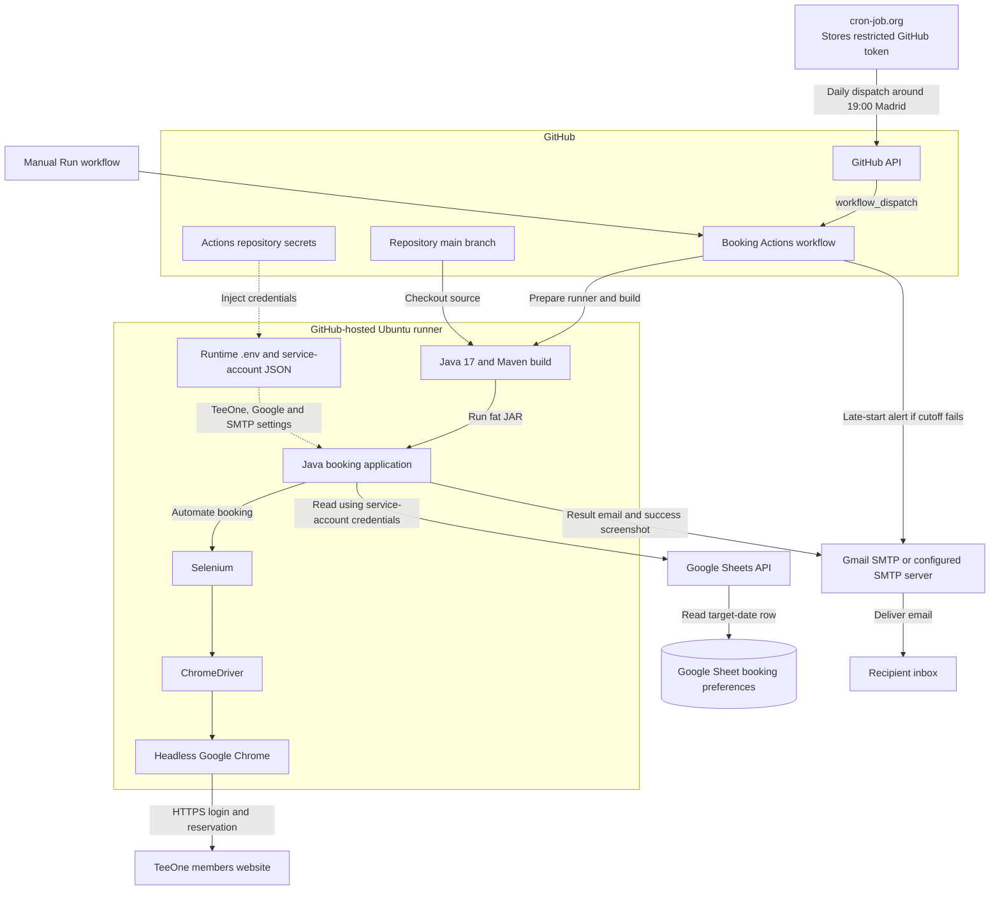

# TeeOne Golf Booking

Automated tee time booking for [TeeOne](https://members.teeone.golf) (Prat). It logs in, fills the inscripción form, and confirms the reserva. Booking preferences come from **Google Sheets**; results are sent by **email**. The app is tuned for **Europe/Madrid** wall-clock behaviour around **20:00** so slots that open on the hour are hit at the right time.

You can run it **locally** (Java + Chrome) or on **GitHub Actions** (externally scheduled or manual).

## Components and services

This diagram shows the GitHub Actions booking path. Solid arrows show
execution or service calls; dotted arrows show credential and configuration
inputs. Local runs use the same Java application and external services,
without cron-job.org or a GitHub runner.

<!-- mermaid-checked: no \n, no em-dash/en-dash, no {} in labels, subgraphs are id["label"], arrows are -->|"label"|, all subgraphs closed by end, ids unique -->


- **Scheduling:** cron-job.org must be configured separately. It stores a restricted GitHub token and dispatches the workflow; it does not run Java or hold the TeeOne, Google, or SMTP credentials. See [External scheduling](#external-scheduling-with-cron-joborg).
- **Execution:** Actions checks the booking cutoff, waits for the build window, checks out `main`, installs Java and Chrome, builds the JAR, and starts the app. The Java app handles the final Madrid-time waits and course/time selection.
- **Secrets:** repository secrets supply the TeeOne login, Google service-account JSON and sheet settings, and SMTP credentials and recipients. The workflow writes runtime `.env` and JSON files on the runner; secret values do not belong in source control or this diagram.
- **Google Sheets:** the Java app reads booking preferences through the Sheets API using the service account. The sheet must be shared with that service account.
- **Browser:** Selenium controls ChromeDriver, which drives headless Chrome against TeeOne. The booking itself uses the website, not the Sheets API or email.
- **Email:** the app sends success/failure details through Gmail SMTP by default, or another configured SMTP server. A confirmed success includes a screenshot when capture succeeds. The workflow can separately send a late-start alert before the app runs.

## Requirements

- **Java 17+** (Maven; set `JAVA_HOME` if needed)
- **Google Chrome** (Selenium 4 manages the driver)
- **Google Cloud** project with Sheets API and a service account
- **SMTP** (e.g. Gmail with an [app password](https://support.google.com/accounts/answer/185833)) for notifications

## Google Sheets

Put these headers in the first row, with one booking preference row per play
date. This CSV example can be imported into Google Sheets (or pasted and split
into columns using a comma separator):

```csv
Fecha,Recorrido,Horario,Socios,Socio-1,Socio-2,Socio-3
20261111,TEE 1 ROSA,08:30,2,100001,,
20261112,TEE 1 AMARILLO,08:35,3,100001,100002,
20261113,TEE 1 VERDE,09:00,4,100001,100002,100003
```

The member numbers above are **fictional examples**; replace them with the
actual socios to add. Empty cells stay empty, not `...` or `N/A`.

- **Fecha**: play date in `yyyyMMdd`, not the day the automation runs. The app selects the row for the **target date** (see [Target date](#target-date) below). For example, a run on 9 November 2026 with the default two-day offset selects `20261111`.
- **Recorrido**: preferred course, using the dropdown label, such as `TEE 1 ROSA` or `TEE 1 AMARILLO`. Rosa and Amarillo automatically fall back to each other if the preferred course has no suitable time. Verde has no alternate-course fallback.
- **Horario**: preferred tee time in `HH:mm` or `H:mm`, for example `08:30` or `8:30`. It is a preference, not an exact-time requirement: the app accepts offered times within **90 minutes before or after it, inclusive**. Keep the displayed cell value in this format, without seconds or AM/PM.
- **Socios**: total player count selected in the form. A time must have enough places for that count.
- **Socio-1**, **Socio-2**, **Socio-3**: member numbers for additional players when **Añadir a otro socio** is used. For two players, fill `Socio-1`; for three, also fill `Socio-2`; for four, fill all three. The logged-in player is already included in the total.

There are **no new columns or settings** for the time window or alternate
course. Do not add a second row for the same date to request fallback; it is
automatic from the single preferred course and time.

### How the first example is selected

For `20261111,TEE 1 ROSA,08:30,2,100001,,`:

1. Select Rosa, 18 holes, and two players. Consider only actual offered times in **07:00 through 10:00**, inclusive, skipping disabled options, placeholders, and insufficient places.
2. Choose the closest eligible Rosa time; earlier wins an equal-distance tie. With Rosa's 08:00 start and ten-minute grid, the order is `08:30`, `08:20`, `08:40`, `08:10`, `08:50`, `08:00`, `09:00`, `09:10`, `09:20`, `09:30`, `09:40`, `09:50`, `10:00`, considering only those actually offered and eligible.
3. Only if Rosa has no eligible time, switch to Amarillo with fresh filters and the **same original 08:30 preference and 07:00-10:00 window**. With Amarillo's 08:05 start and ten-minute grid, the order is `08:25`, `08:35`, `08:15`, `08:45`, `08:05`, `08:55`, `09:05`, `09:15`, `09:25`, `09:35`, `09:45`, `09:55`, again considering only eligible offered times.
4. Reserve the selected slot. If neither course has a suitable time, report failure without clicking BLOQUEAR. A failure during BLOQUEAR or RESERVAR does **not** trigger another course or reservation attempt.

**Course preference comes before time proximity:** an available Rosa 10:00
is selected ahead of Amarillo 08:25. If Rosa has no suitable slot and Amarillo
08:25 is selected, the success email reports **Amarillo at 08:25**, not the
requested Rosa at 08:30. Emails also include the time options from the last
course inspected when that list was read.

For the second row, the same rules run in reverse: Amarillo first, then Rosa
only if needed, within **07:05-10:05**. For the Verde row, only Verde's actual
offered times within **07:30-10:30** are considered; no Verde start time or
ten-minute grid is assumed.

### Service account

1. [Google Cloud Console](https://console.cloud.google.com/) → enable **Google Sheets API**
2. **Credentials** → **Service account** → download JSON key
3. Locally: e.g. `credentials/google-service-account.json`
4. **Share the sheet** with the service account email (at least Viewer)

## Local environment

```bash
cp .env.example .env
# Edit .env
```

**Required (typical):**

- `TEEONE_USERNAME`, `TEEONE_PASSWORD`
- `GOOGLE_CREDENTIALS_PATH` (e.g. `./credentials/google-service-account.json`)
- `GOOGLE_SHEET_ID`
- `EMAIL_FROM`, `EMAIL_PASSWORD`, `EMAIL_TO` (and SMTP host/port/TLS as needed)

**Optional (see [Optional environment variables](#optional-environment-variables)):** `SKIP_MADRID_TIME_WAIT`, `BOOKING_TARGET_DATE_OFFSET_DAYS`, `HEADLESS`, etc.

## Build and run (local)

```bash
export JAVA_HOME=$(/usr/libexec/java_home -v 17)   # macOS example
mvn clean package assembly:single
java -jar target/teeone-booking-jar-with-dependencies.jar
```

Or: `mvn exec:java -Dexec.mainClass="com.prat.booking.Main"`

## GitHub Actions

Workflow: [`.github/workflows/teeone-book.yml`](.github/workflows/teeone-book.yml) — **TeeOne booking (scheduled)**.

### Triggers

| Trigger | When |
|--------|------|
| **workflow_dispatch** | Run manually via **Actions** → workflow → **Run workflow**, or through the GitHub API from an external scheduler. With **skip_madrid_time_wait=false**, the workflow **waits until 19:35** Madrid before setup, `mvn`, and the JAR; the app waits until **19:59:20 / 20:00:01** for login and form fill. If the runner starts after **19:57** Madrid, the job **fails fast before setup** (no booking attempt) and attempts an email alert using the SMTP secrets. |

The built-in GitHub cron trigger is disabled. Automatic daily runs require an external scheduler to be configured separately; until then, only manual/API dispatches run. Dispatch daily around **19:00 Europe/Madrid** with **skip_madrid_time_wait=false** and **target_date_offset_days=2**. Hosted-runner startup can still be delayed.

### External scheduling with cron-job.org

[cron-job.org](https://cron-job.org/en/faq/) sends one HTTP request each day to dispatch the workflow. It does **not** run Java or hold the HTTP connection open until booking time. GitHub accepts the request, queues a runner, and the workflow/application handle the waits.

#### Daily execution timeline

All times below are **Europe/Madrid**, including daylight-saving changes:

1. **19:00:** cron-job.org sends the dispatch request to GitHub. The HTTP response confirms whether the request was accepted, not whether a booking succeeded.
2. **When the runner starts:** the workflow checks the clock. After **19:57:00**, it fails before checkout/setup and attempts a late-start email alert; no booking is attempted.
3. **Until 19:35:** the runner waits before checkout, Java/Chrome setup, credentials creation, and the Maven build. A runner starting between 19:35 and the cutoff skips this wait and starts setup immediately.
4. **Around 19:59:20:** the Java application starts browser/login preparation, aiming for login and the **Recorrido** field to be ready by **19:59:50**.
5. **Around 20:00:01:** the application starts filling the booking form, attempts the reservation, and sends the result email.

These are intended timings, not a punctuality guarantee. External scheduling avoids GitHub's built-in cron-trigger delays, but cron-job.org, runner allocation, setup/build, and the booking site can still be delayed. The initial cutoff does not guarantee that a slow setup/build finishes in time.

#### Create a restricted GitHub token

In GitHub, open **Settings → Developer settings → Personal access tokens → Fine-grained tokens**:

1. Create a token for the repository owner and select **only `java-prat-booking`**.
2. Grant repository permission **Actions: Read and write**.
3. Set an expiration and a renewal reminder. If owner/organization approval is required, obtain it before testing.

The direct integration requires storing this token in cron-job.org's request settings. Treat it as a secret: never put it in the URL, commit it, or include it in screenshots/logs. Revoke and replace it if exposed, and update the scheduler before it expires. TeeOne, Google Sheets, and SMTP credentials remain in **GitHub Actions secrets**, not in cron-job.org.

#### Configure the cron-job.org job

Create an account and one enabled job with:

- **Schedule:** every day at **19:00**.
- **Timezone:** **Europe/Madrid**; verify the displayed next execution time before enabling the job.
- **HTTP method:** **POST**.
- **URL:**

```text
https://api.github.com/repos/nicokiki/java-prat-booking/actions/workflows/teeone-book.yml/dispatches
```

In the advanced request settings, add these headers, replacing the token placeholder privately:

```text
Authorization: Bearer YOUR_GITHUB_TOKEN
Accept: application/vnd.github+json
Content-Type: application/json
X-GitHub-Api-Version: 2022-11-28
```

Set the request body to:

```json
{
  "ref": "main",
  "inputs": {
    "skip_madrid_time_wait": false,
    "target_date_offset_days": "2"
  }
}
```

Explicitly passing **false** is essential: the workflow input defaults to **true**, which bypasses both the timing checks and waits. The workflow must be present on GitHub's default branch, and `main` must contain the dispatch-enabled version.

Enable scheduler failure notifications. Avoid automatic retries or a second scheduler that can dispatch duplicate runs: a retry after an ambiguous HTTP timeout may create another run even if GitHub accepted the first request. The workflow's **cancel-in-progress** setting cancels an active run when another is dispatched; it does not deduplicate completed bookings.

#### Verify and operate

Testing the HTTP request launches the **real booking workflow**. Test only on an intended booking day, before **19:57 Madrid**, and do not issue another test while a run is active. Neither bypassing the waits nor changing the target date makes a run a dry run.

1. Check cron-job.org's execution history. A successful dispatch normally returns **HTTP 204 No Content**; an empty response is expected.
2. Open **GitHub → Actions → TeeOne booking (scheduled)** and confirm a new run appeared on `main`.
3. Check that the late-start guard passed and the **Wait until pre-build window** step waits until 19:35 (or reports that the time has already passed).
4. Check the eventual GitHub run result and booking email. Scheduler success only confirms dispatch; it does not monitor the later Actions job or reservation.

For a rejected request, check the token's validity, repository selection, Actions permission, workflow filename, branch, and JSON body. If a request times out, inspect GitHub Actions before retrying. For a late-start email, inspect the runner's start time; repeatedly dispatching cannot recover the missed booking window.

For a manual fallback, use **Run workflow**, uncheck **skip_madrid_time_wait**, and select **target_date_offset_days=2** before the cutoff. First confirm no daily run is already active or has completed the booking.

**Activation checklist:** workflow changes pushed to `main`; token created; cron-job.org configured and enabled; next execution time checked; one intended booking run verified. Until the external job is enabled, there are **no automatic daily triggers**. Pause the cron-job.org job to stop future automatic dispatches; pausing it does not cancel a run already queued or running in GitHub.

### Repository secrets

Configure these under **Settings → Secrets and variables → Actions** (names must match the workflow):

| Secret | Purpose |
|--------|--------|
| `TEEONE_USERNAME` | TeeOne login |
| `TEEONE_PASSWORD` | TeeOne password |
| `GOOGLE_SHEET_ID` | Sheet ID from URL |
| `GOOGLE_SHEET_RANGE` | A1 notation range (optional; default `Sheet1!A:Z` if empty/omitted in workflow env) |
| `GOOGLE_CREDENTIALS_JSON` | Full service account JSON (single line / stored as secret) |
| `EMAIL_FROM` | SMTP from |
| `EMAIL_PASSWORD` | SMTP password (e.g. app password) |
| `EMAIL_TO` | Recipient |
| `EMAIL_SMTP_HOST` | e.g. `smtp.gmail.com` |
| `EMAIL_SMTP_PORT` | e.g. `587` |
| `EMAIL_SMTP_SSL` | `true` or `false` |
| `EMAIL_SMTP_STARTTLS` | `true` or `false` |
| `DASHBOARD_PUBLISH_TOKEN` | Publish saved results to `java-prat-booking-dashboard` (Contents: Read and write on that repository only) |

The workflow writes `credentials/google-service-account.json` and a runtime `.env` on the runner, then builds a fat JAR and runs `java -jar target/teeone-booking-jar-with-dependencies.jar`.

### Manual run inputs (workflow_dispatch)

When you click **Run workflow**, you can set:

| Input | Default | Meaning |
|--------|---------|--------|
| **skip_madrid_time_wait** | `true` (checked) | If **true**: bypass the 19:35 wait, late-start check, and internal Europe/Madrid waits (see [Time window](#time-window-europemadrid)); the flow runs as soon as the JAR starts. If **false**: enforce the 19:57 cutoff and use the production waits. External schedulers must explicitly pass **false**. |
| **target_date_offset_days** | `2` | `0` = today, `1` = tomorrow, `2` = in two days — for **which sheet row** and, when the sheet’s **Fecha** is empty, the booking URL date. External schedulers should pass **2**. |

The workflow maps these to process environment variables for the JAR:

- `SKIP_MADRID_TIME_WAIT` = `true` or `false` from the dispatch input
- `BOOKING_TARGET_DATE_OFFSET_DAYS` = `0`, `1`, or `2` from the dispatch input

### Tips

- For an **immediate run** in CI: leave **skip_madrid_time_wait** checked and pick **target_date_offset_days** as needed. This is not a dry run: it can make a real booking.
- For a **time-accurate rehearsal** (rare on Actions): uncheck **skip_madrid_time_wait**; note the job can still start late relative to 20:00 because of the queue.
- Job **timeout** is 360 minutes for all dispatches, including the idle wait until 19:35 when enabled.
- For an external scheduler calling `workflow_dispatch`, set **skip_madrid_time_wait** to **false** and **target_date_offset_days** to **2**. External scheduling requires separate setup. Avoid dispatching another run while one is active: the shared concurrency group cancels the previous run, and does not prevent duplicate bookings after a completed run.

## Target date

- **Default:** `LocalDate.now()` + **`BOOKING_TARGET_DATE_OFFSET_DAYS`** (default **2** days) — used to find the **Google Sheet** row and, when the row has no **Fecha**, to build the inscripción URL date.
- **Override:** set `BOOKING_TARGET_DATE_OFFSET_DAYS` in `.env` or, on GitHub, via the **target_date_offset_days** dispatch input.

## Time window (Europe/Madrid)

When **`SKIP_MADRID_TIME_WAIT`** is **not** set (or `false`):

| Step | Time (Madrid, same day as `performBooking` starts) |
|------|------------------------------------------------------|
| Start browser / driver | **~19:59:20** |
| **Login** + **Recorrido** visible | **By ~19:59:50** (deadline) |
| Start form fill (Recorrido, hoyos, jugadores, hora, …) | **~20:00:01** |

If the JVM starts **after** these times, the code does **not** wait backwards; it continues immediately (with “already past deadline” style logs). So for predictable behaviour the process should start **before** ~20:00 Madrid.

## Bypassing the Madrid wait

- **Local:** in `.env` set `SKIP_MADRID_TIME_WAIT=true` (or export it in the shell).
- **GitHub — manual run:** use the **skip_madrid_time_wait** input (default true = bypass).
- **GitHub — externally scheduled run:** pass **skip_madrid_time_wait=false**; the workflow enforces the late-start cutoff and the app uses the normal Madrid window.

## Optional environment variables

| Variable | Default | Purpose |
|----------|---------|--------|
| `SKIP_MADRID_TIME_WAIT` | unset → false | `true` skips the 19:59:20 / 20:00:01 Madrid waits (process env, then `.env`) |
| `BOOKING_TARGET_DATE_OFFSET_DAYS` | `2` | `0`–`2` — days from today for sheet/URL (process env, then `.env`) |
| `HEADLESS` | `true` | `false` shows Chrome (useful when debugging) |
| `WAIT_AFTER_RECORRIDO_MS` | Not used | Legacy setting; readiness waits now replace the fixed inter-dropdown pause |
| `DEBUG_WAIT_AFTER_JUGADORES_MS` | Not used | Legacy setting; Hora de juego now waits for usable options |
| `EMAIL_DEBUG` | `false` | Jakarta Mail debug |
| `EMAIL_TIMEOUT_MS` | `15000` | SMTP timeouts |

## Flow (summary)

1. Load configuration; resolve **target date** and read the matching **Google Sheet** row.
2. (Unless skipped) **Wait** until the configured **Europe/Madrid** instants, then open the inscripción URL, log in, and wait for **Recorrido**.
3. Fill **Recorrido** (with waits for options/AJAX), **Número de hoyos**, **Jugadores**, **Hora de juego**; then **BLOQUEAR**, add socios, **RESERVAR**.
4. Save the structured result before sending email; include **Hora de juego** option labels in the email if that step ran.
5. On GitHub Actions, back up the saved report and publish its allowlisted data to the public dashboard. Notification or publication failures do not retry the booking.

### Form readiness and validation

Each dropdown is re-found every 200 ms until it is visible, enabled, and contains
an enabled matching option. Recorrido allows up to 25 seconds; Número de hoyos
and Jugadores allow 15 seconds. Hora de juego allows 3 seconds for an enabled,
nonblank option other than the `-1` placeholder, then applies the existing time
and player-count preferences. An empty-dropdown timeout is reported separately
from a populated list with no matching time. BLOQUEAR waits up to 15 seconds
to become visible and enabled before a normal Selenium click.

The three-second time-dropdown limit applies on each course. It speeds up
fallback from an empty list, but a preferred course whose times arrive later
than that limit may be skipped. The separate AJAX waits are unchanged.

Time selection ranks the actual offered slots within **90 minutes before or
after the sheet's Horario, inclusive**: closest first, earlier first on a tie.
Disabled options, placeholders, and insufficient player counts are skipped;
the existing same-time preference for plain times, then `(4)`, `(3)`, `(2)`
(as allowed by Socios) remains. No opening time or grid is assumed, including
for Verde.

The requested course always takes priority. Only if it has no suitable time
(including a usable dropdown remaining empty or all-disabled after the wait),
**ROSA falls back to AMARILLO, and AMARILLO to ROSA**. The other course gets
fresh course/hole/player selections and the same original Horario and
90-minute window. Thus requested Rosa at 08:30 can select Rosa at 10:00 before
considering Amarillo at 08:25. Verde has no alternate-course fallback.
Success emails report the actual selected course and time in both subject and
booking details. The option list is from the last course inspected.

The post-Recorrido AJAX wait remains, with another wait after the player filter.
These checks do not guarantee
that an already-populated dropdown reflects the latest server response, or
that no overlay covers BLOQUEAR. Course fallback is availability-only and
occurs before BLOQUEAR. Other errors and failures or uncertain results during
BLOQUEAR or RESERVAR do not trigger another course or reservation attempt.

Run `mvn test` for mock-only regression tests, or
`mvn clean package assembly:single` to also build the production JAR. The
**Validate booking automation** workflow runs this build for PRs and pushes to
main without credentials, email, or a live booking. Future booking dispatches
check out main and rebuild the JAR. To roll back a merged change, use the PR's
**Revert** action and merge the resulting revert PR before the next dispatch.

### Socio readiness

After BLOQUEAR, each additional socio is looked up by the **exact licence**
from the sheet, not a partial licence match. The app polls every 200 ms for
up to five seconds for a visible popup, then up to five seconds for the
matching row and a visible, enabled plus icon. Rows are re-found on each poll
to tolerate asynchronous loading and table replacement; there is no fixed
two-second pause after opening the popup.

After the plus click, the app waits up to five seconds for the exact licence
and member ID to appear in TeeOne's `inscripcionData.listaSocios` model and
for the corresponding member-ID row to be visible in `#table-jugadores`.
Popup closure alone is not considered proof of addition. If this update
cannot be verified, or the requested row never becomes ready, the run stops
before RESERVAR and sends the failure email. Timeout logs include popup
visibility and licence-row counts without dumping the page or credentials.
An uncertain click failure does not trigger another click, course switch,
or reservation attempt; the JavaScript click fallback is only used for an
intercepted click. An incorrect or unavailable licence still needs correction
in the sheet or TeeOne friends list.

### Successful booking screenshot

The success email subject uses the format
`TeeOne Booking -- Success -- dd/MM/yyyy @ HH:mm @ Rosa | Blocked at hh:mm:ss AM/PM | Booked at hh:mm:ss AM/PM`.
The date is the golf play date (`Fecha`), the tee time is the actual selected
option (including fallback times, without the player-count suffix), and the
course is shortened to Rosa, Verde, or Amarillo. Both timestamps use
`Europe/Madrid`, including daylight-saving adjustments:

- **Blocked at:** captured immediately before the BLOQUEAR click call and retained if the call returns successfully. It records when the click was initiated, not proof of a successful server-side hold.
- **Booked at:** recorded when the existing success-message check passes after RESERVAR, before screenshot capture or email delivery. It records confirmation detection, not a server-provided transaction timestamp.

The body includes both **Blocked at** and **Booked at** as
`hh:mm:ss:SSS AM/PM` with three-digit milliseconds, their respective dates,
and the Madrid UTC offset. Both fields are reset for each booking attempt;
missing timestamps are omitted rather than invented. Neither is the scheduled
tee time.

After RESERVAR has been clicked and the existing success-message check confirms
the reservation, the automation captures the visible browser viewport as a PNG.
The success email includes it as `booking-confirmation.png`, alongside the
existing booking details and time-option list. No screenshot is taken before
confirmation or for an unsuccessful reservation, so capture cannot delay
BLOQUEAR, adding socios, or RESERVAR.

Capture is best-effort: an empty image or capture exception is logged without
changing booking success, and the email is sent without an attachment. The
image stays in memory until email delivery; no screenshot file or Actions
artifact is created. It shows only what is visible on the confirmation page,
not necessarily every socio or content below the viewport. Treat the email as
private because the screenshot may contain member and reservation details.

## Local cron (optional)

To mirror production timing on your own machine (no GitHub queue), run the JAR in **`Europe/Madrid`** a few **minutes before** 20:00, e.g.:

```cron
CRON_TZ=Europe/Madrid
50 19 * * * cd /path/to/java-prat-booking && /usr/bin/java -jar target/teeone-booking-jar-with-dependencies.jar >> logs/cron.log 2>&1
```

The **application** then applies its own 19:59:20 / 20:00:01 waits (without `SKIP_MADRID_TIME_WAIT`).

## Dashboard results

The application saves `results/booking-result.json` before email notification.
The allowlisted report contains the requested and actual booking, Madrid
timestamps, outcome, requested participants, and observed tee-time options for
each checked course. Names are captured from TeeOne when observed; missing names
or the booking holder's licence remain unrecorded rather than being guessed.
Socios' requested licences come from the sheet. Reports contain no passwords,
Google credentials, screenshots, reservation alerts, or raw exceptions.

Outcomes are `Confirmed`, `Unavailable`, `Uncertain`, or `Technical failure`.
Any submission attempt without an observed success message is `Uncertain`;
check existing reservations before attempting recovery. Notification and
publication failures never rerun the booking.

The scheduled workflow backs up the JSON as a `booking-result-*` artifact for
90 days. This repository is public, so the backup is not a private-data vault.
The persistent public history is hosted at
https://nicokiki.github.io/java-prat-booking-dashboard/.

### Rollout status (2026-11-14)

**Steps 1-6 are complete; Step 7 is pending.**

1. **Public-data scope:** approved public booking details, names, and licencias; credentials and screenshots are excluded from reports.
2. **Dashboard setup:** created the public dashboard repository and enabled GitHub Pages.
3. **Structured results:** implemented outcomes, Madrid timestamps, participants, and observed availability, saved before email.
4. **Publication pipeline:** implemented artifact backup and allowlisted, execution-ID-based publication; `DASHBOARD_PUBLISH_TOKEN` is configured in this repository's Actions secrets.
5. **Real-data dashboard:** replaced fictional records with saved JSON and pushed both integrations to `main`. Booking integration commit: `ff61a48`; dashboard integration commit: `78e99ee`.
6. **Safe validation:** local Java and publisher tests, the Java-to-publisher dry-run, and the final JAR build passed. The [no-booking check](https://github.com/nicokiki/java-prat-booking/actions/runs/43621477702) and [Pages deployment](https://github.com/nicokiki/java-prat-booking-dashboard/actions/runs/43621458180) succeeded. No real booking or email was triggered for these checks.
7. **Pending:** verify the next normal scheduled booking and its published result using the checklist below. The token's actual write access has not yet been exercised.

At this checkpoint, the public archive is empty, as expected. No fictional
records were published, and no extra booking or availability-only schedule was
added for verification.

### Publishing setup

1. Create a fine-grained GitHub personal access token owned by `nicokiki`,
  restricted to `java-prat-booking-dashboard`, with **Contents: Read and write**.
  Use an expiry and renew it before expiration. No Actions or administration
  permissions are needed.
2. In this booking repository, open **Settings > Secrets and variables > Actions**
  and add the token as a repository secret named `DASHBOARD_PUBLISH_TOKEN`.
  Enter it directly on GitHub, never in chat or in a committed file.
3. The normal booking workflow will publish saved results to
  `data/executions.json` in the dashboard repository. If the token is absent or
  publishing fails, the saved report remains in the artifact; no booking retry
  is performed.

### Safe validation and first-run verification

Run `mvn -B clean test` and `python3 .github/scripts/test_publish_dashboard.py`
locally, or dispatch **Dashboard publishing check (no booking)**. That workflow
runs mocked report tests and fixture publisher tests, then validates the exact
Java-generated fixture against the dashboard archive with a publisher dry-run;
it does not open TeeOne, send email, or push fixture data. Publisher dry-run:
`python3 .github/scripts/publish_dashboard.py REPORT_JSON DASHBOARD_REPO --dry-run`.

**Step 7: verify the next normal scheduled booking, not an extra test booking.**

1. Confirm the `booking-result-*` artifact contains the saved execution report.
2. Check the dashboard checkout and publication steps, confirming that the configured token can write to the dashboard repository. Publication is best-effort, so a green workflow alone does not prove publication succeeded.
3. Match the report's execution ID and outcome to the public archive and dashboard. Check the actual course/time for a confirmed booking; an uncertain result must not claim confirmation.
4. Check participants' names and licencias, ensuring missing identities remain unrecorded, and compare course snapshots with the saved report.
5. Confirm Pages serves the new record after deployment. For an uncertain result, inspect existing TeeOne reservations before any recovery attempt; do not rerun the booking merely to test publication.

A green workflow alone is not proof of booking.
If the runner is stopped before it saves a report, no booking claim is published.
This change does not schedule availability-only runs. History comparisons need
repeated observations for the same play date, player count, and 18 holes.

## Troubleshooting

- **No slots / BLOQUEAR disabled** — the club may show “no availability”; fix date, recorrido, and jugadores on the real site; automation cannot invent tee times.
- **Chrome / headless** — ensure Chrome is installed; set `HEADLESS=false` to watch the browser.
- **Selectors** — if TeeOne’s HTML changes, update `TeeOneAutomation.java`.
- **Sheet tab** — if not `Sheet1!A:Z`, set `GOOGLE_SHEET_RANGE` in secrets / `.env`.
